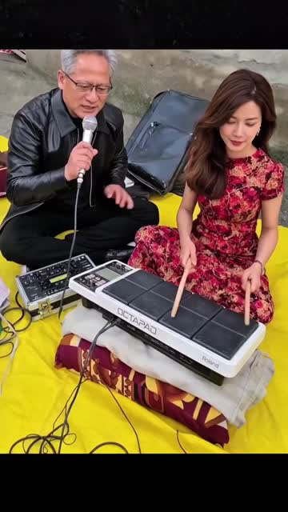

# Jensen Huang singing AI video: the Singing Duo recipe

Put yourself and a friend into the singing-and-drum-pad performance from the
Jensen Huang AI meme. Start with the reference clip, prepare photos for each
person, and explicitly map the singer and drum-pad player.

**[Make it in Videozypher →](https://affogato.ai/app/videozypher)**
Choose **Jensen Huang Singing Duo** in the reference library.

[](https://affogato.ai/app/videozypher)

*The preview is the AI-edited reference, not a newly generated result. “Jensen Huang
Singing Duo” is our descriptive template name; the song title is unverified.*

This follows the recipe format of my
[Hotel Lobby repo](https://github.com/MaruPelkar/vaaya-recipe-hotel-lobby-h3):
prepare the inputs, map each person's photos, then generate. I build
[Affogato AI](https://affogato.ai); Videozypher packages the cast-swap workflow.

## What's in here

| File | Purpose |
|---|---|
| [prompt.txt](prompt.txt) | Editable performance and identity instructions. |
| [request.json](request.json) | Affogato cast-swap request with file-ID placeholders. |
| [reference.json](reference.json) | Reference-video URL, dimensions and library entry. |
| [agent-prompt.txt](agent-prompt.txt) | Instructions you can give an MCP-connected agent. |

Download with **Code → Download ZIP**, or clone this repository.

## The easiest way

1. Open [Videozypher](https://affogato.ai/app/videozypher).
2. Select **Jensen Huang Singing Duo** from the reference library.
3. Add your two replacement people. For each, use a clear face close-up and a
   full-body photo. Use consistent hair and clothing across that person's photos.
4. Map the singer to the viewer's **left** and the drum-pad player to the **right**.
5. Keep the original sound enabled, review the credit cost, then generate.
6. Check faces, hands, drumsticks and audio timing before sharing.

The reference is a 30-second, 720 × 1280 MP4 with audio. Try a short section first
if you want to check the identities before generating the full clip.

## Why the mapping matters

The video supplies the motion and timing; your photos supply the new identities.
The common failure is assigning a close-up to the wrong performer.

For a manual model interface, label the four photos explicitly:

- Image 1: singer, full body.
- Image 2: singer, face close-up.
- Image 3: drum-pad player, full body.
- Image 4: drum-pad player, face close-up.

Use the reference-token syntax that your chosen model supports. The Affogato
request groups photos under each subject, so you do not need to guess hashtag syntax.
A prompt is guidance, not a guarantee of perfect identity or motion preservation.

## Run it with your agent

Connect an MCP-capable agent to **https://api.affogato.ai/mcp** and sign in to
Affogato. Setup: [Affogato MCP guide](https://affogato.ai/mcp).

Give it [agent-prompt.txt](agent-prompt.txt), this repo, and your photos:

> Use Affogato to run the Singing Duo recipe in this repo. Assign my first pair
> of photos to the singer and my second pair to the drum-pad player. Keep the
> reference audio. Tell me the cost before generating.

The recipe uses Affogato's **cast_swap** tool. It does not install a local video model.

## REST API version

Create an API key through [Affogato Developers](https://affogato.ai/developers).
Set it as the environment variable `AFFOGATO_API_KEY`; never commit it.

**1. Upload the inputs.** Download the reference from `video_url` in
[reference.json](reference.json), or use your own 4–30 second performance clip.

Upload the video and each photo separately:

```bash
curl --fail-with-body https://api.affogato.ai/v1/files \
  -H "Authorization: Bearer $AFFOGATO_API_KEY" \
  -F "file=@reference.mp4"
```

Repeat with each photo. Keep each returned `id`.

**2. Fill in [request.json](request.json).** Replace all five placeholders with
the corresponding uploaded file IDs. These fields take **file IDs, not URLs**.
Save your filled request as `request.local.json`.

**3. Generate.** This call spends credits. Check current pricing and your budget first.

```bash
curl --fail-with-body 'https://api.affogato.ai/v1/studios/cast-swap?wait=25' \
  -H "Authorization: Bearer $AFFOGATO_API_KEY" \
  -H "Content-Type: application/json" \
  --data-binary @request.local.json
```

If the response is `queued` or `processing`, poll its generation ID:

```bash
curl --fail-with-body 'https://api.affogato.ai/v1/generations/GENERATION_ID?wait=25' \
  -H "Authorization: Bearer $AFFOGATO_API_KEY"
```

Repeat until `succeeded`, `failed` or `cancelled`. Successful media is in
`outputs`. Do not submit another POST just because the first call is still processing.

## Troubleshooting

- **Faces blend or roles swap:** check the subject mapping and use distinct, sharp photos.
- **Hands or sticks distort:** try a shorter segment with fewer occlusions.
- **The voice did not change:** retaining the original sound preserves the soundtrack;
  this recipe does not clone the replacement people's voices.
- **Results vary:** reference-guided generation can require retries. Budget for them.
- **Pricing:** generation uses Affogato credits. See [current pricing](https://affogato.ai/pricing);
  this repo does not promise free renders or a fixed price.

## Source and verification

Reference context: [the Reddit discussion](https://www.reddit.com/r/generativeAI/comments/1xt04vn/how_are_people_making_this_kind_of_videos/).
The supplied reference was added to Videozypher's library; the last 0.25 seconds
were removed to fit the 30-second limit.

The request shape was checked against the
[live Affogato API schema](https://api.affogato.ai/v1/openapi.json).
This repository has not yet been validated with a new end-to-end generation using
replacement photos.

Use photos of yourself or people who agree to appear, and footage/audio you have
permission to reuse. Label shared outputs as AI-edited. Reference media remains
subject to its owners' rights; inclusion here does not grant a media license.
